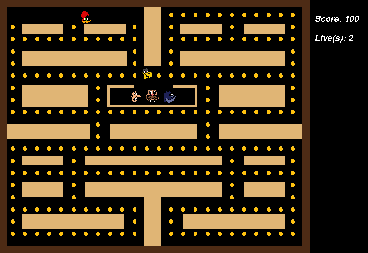

# Pac-Man — Pica-Pau Edition

A Pac-Man-style maze game in **Python** with **pygame**, themed after the *Pica-Pau* (Woody Woodpecker) cartoon. You eat every dot in the maze while four ghosts chase you; power-ups appear over time to swing the odds. The in-game text is in Portuguese; this README is in English.



## Gameplay

| Key | Action |
| --- | --- |
| `W` `A` `S` `D` | Move |
| `Enter` | Start / play again |

- Eat all **226 dots** to win. Each dot is worth 10 points.
- You have **3 lives**. Touching a ghost costs a life and sends everyone back to their starting positions.
- The four ghosts leave their house two seconds apart and **chase you** by moving towards your position.
- Power-ups appear at fixed times and places:

| Power-up | Appears after | Effect |
| --- | --- | --- |
| ⚡ Speed | 10 s | Faster movement for 5 seconds |
| ❤️ Life | 20 s | +1 life |
| Invincibility | 25 s | 5 seconds in which touching a ghost sends *it* back home |

## Running

Requires Python 3.10+.

```bash
pip install -r requirements.txt
python src/main.py
```

Assets are resolved relative to the source files, so the game can be launched from any directory.

## Code structure

```
src/
├── main.py       # Screens (start, victory, game over), match loop, scoring and power-up schedule
├── boneco.py     # Characters: base class, Pac-Man (movement, animation, collisions) and ghosts (chase AI)
├── mapa.py       # Maze layout: outer walls, inner barriers, ghost-house door
├── bolinha.py    # Dot grid generation (skipping walls and the ghost house) and rendering
├── poder.py      # Power-ups
└── recursos.py   # Asset path helpers
assets/
├── images/       # Sprites and screens
└── sounds/       # Music and sound effects
```

## Changes in this revision

- **Restart and quit fixed.** Each "play again" used to call the game function recursively from inside the end screen, so the call stack grew with every match. Closing the window after a rematch then crashed with a pygame error, because the outer screens kept running after `pg.quit()`. The game is now a simple loop: start screen → match → result screen → match.
- **The life power-up could be applied twice** in one frame, because the power-up check was duplicated in the main loop. A single check now handles all power-ups.
- Victory is detected when the maze has no dots left, instead of with a hard-coded score threshold.
- Assets moved to `assets/` and code to `src/`. Previously the code lived in a folder named `jogo.py` and only ran from the repository root. Unused sprites and sounds, a duplicate `Poder` class and compiled `__pycache__` files were removed.

## Known limitations

- Movement speed is defined per frame and the loop has no frame-rate cap, so the game runs faster on faster machines. Moving to time-based movement with `pygame.time.Clock` would need the speeds to be retuned through playtesting.
